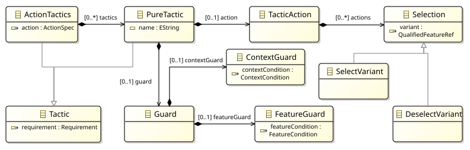
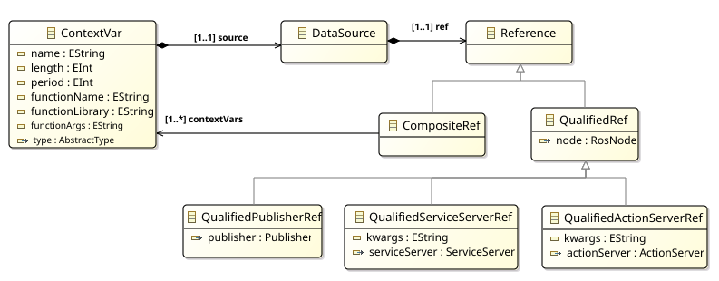
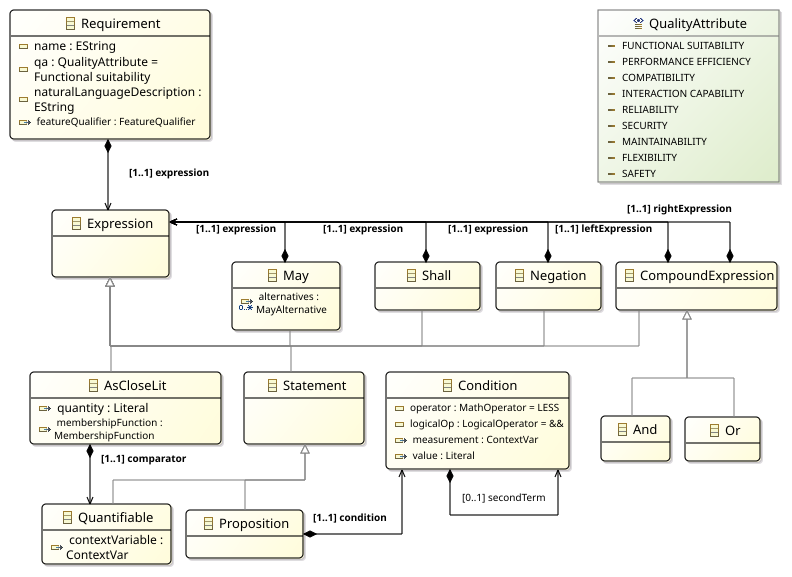
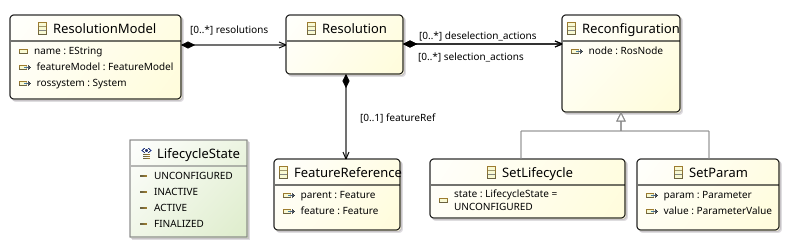
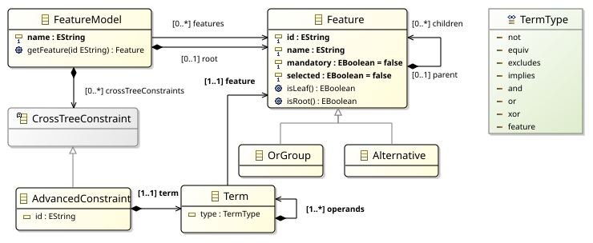

# Tactical Retreat - ECore Model and XText DSL Projects

Important Files:
It is quite a hassle to navigate through java projects, There are some hyperlinks to help you:

For reference:
The Xtext Grammar defines what a user is able to type in to define an DSL entry.
A generator transforms the Java objects of a DSL entry into anything else you may like e.g. text.
A scope provider determines how the references in the DSL are handled. For example, if I refer to parameter in a the Tactics model which is a concept from an Architecture model, then I can put logic there to constrain those parameters to only those that belong a specific component.
A validator determines if a DSL entry passes, beyond its grammar. This is like determining what is a logic error vs. a syntax error. The grammar determines the latter, the validator the prior.

## Adaptation Tactics Model: 
The Tactics model allows you define conditioned rules or tactics for transitioning between the variants of functionality, as described in the variability model. The implication of selection and deselection of each variant on the software architecture is described in the Resolution model.

 
[XText Grammar Definition](eu.coresense.adaptation/src/eu/coresense/adaptation/Tactics.xtext)

[TQL Generator](eu.coresense.adaptation/src/eu/coresense/adaptation/generator/TQLGenerator.xtend)

[Scope Provider](eu.coresense.adaptation/src/eu/coresense/adaptation/scoping/TacticsScopeProvider.java)

[Validator](eu.coresense.adaptation/src/eu/coresense/adaptation/validation/TacticsValidator.java)

## Context Model:
The Context model represents facets of information about the robot's context (environment, mission, user) as context variables. These are based on data sources in the software architecture e.g. ROS2 Topic.

[XText Grammar Definition](eu.coresense.context/src/eu/coresense/context/ContextModel.xtext)

[Scope Provider](eu.coresense.context/src/eu/coresense/adaptation/scoping/ContextModelScopeProviderr.xtend)

[Validator](eu.coresense.context/src/eu/coresense/adaptation/validation/ContextModelValidator.java)

## Requirements Model:
The Requirements model allows you to specify quality requirements for the system, in the RELAX language. The language is based on fuzzy branching temporal logic, allowing the specification of requirements with a fuzzy [0,1] satisfaction. Requirements use context variables to represent runtime quantifiables.

[XText Grammar Definition](eu.coresense.requirements/src/eu/coresense/requirements/RequirementsModel.xtext)

## Resolution Model:
The Resolution model maps the selection and deselection of a variant to changes in the software architecture, in this case through ROS 2 parameters changes or lifecycle state transitions.

[XText Grammar Definition](eu.coresense.resolution/src/eu/coresense/resolution/ResolutionModel.xtext)

[Scope Provider](eu.coresense.resolution/src/eu/coresense/resolution/scoping/ResolutionModelScopeProviderr.xtend)

[Validator](eu.coresense.resolution/src/eu/coresense/resolution/validation/ResolutionModelValidator.java)

## Variability Model
The variability model is a feature model, each abstract feature should represent the variation point of some functionality or its decomposition. The leaf features represent variants of that variation.

[XText Grammar Definition](eu.coresense.variability/src/eu/coresense/variability/FeatureModel.xtext)

[Validator](eu.coresense.variability/src/eu/coresense/variability/validation/FeatureModelValidator.java)
