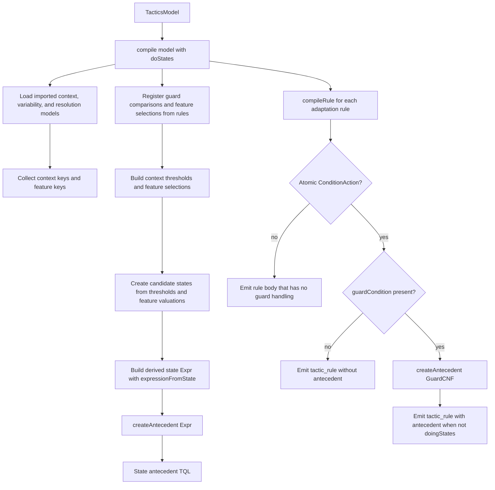
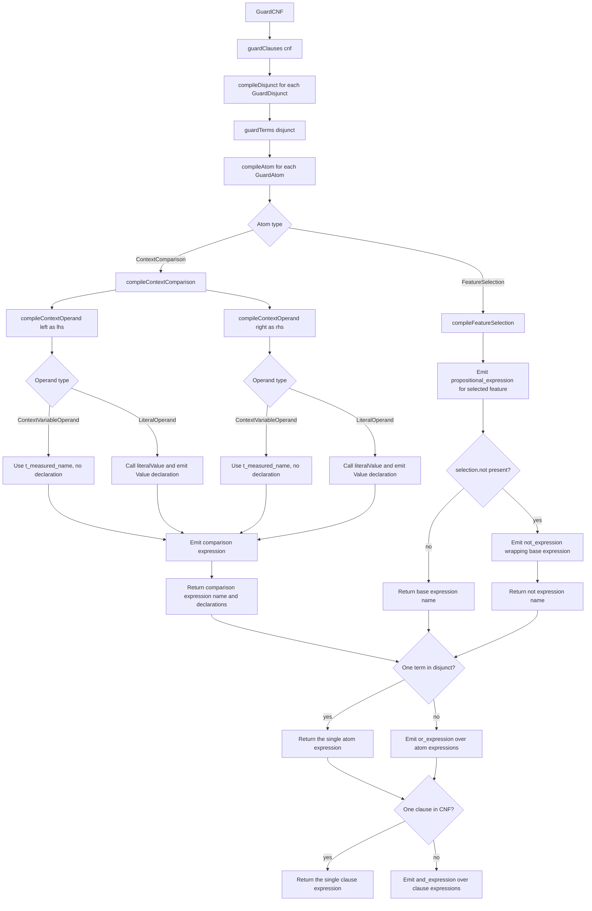
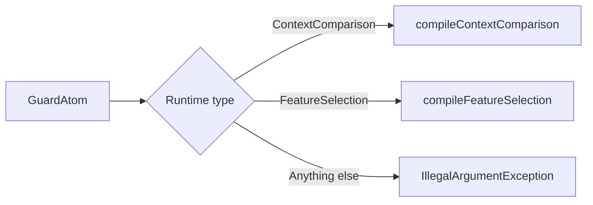
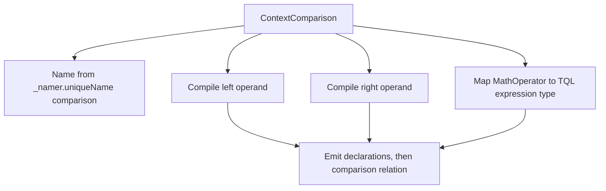
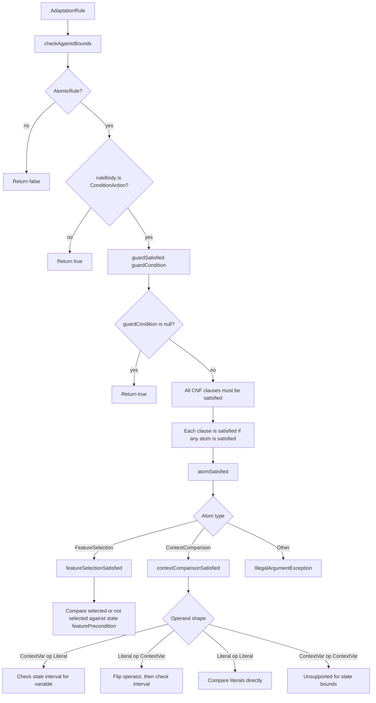
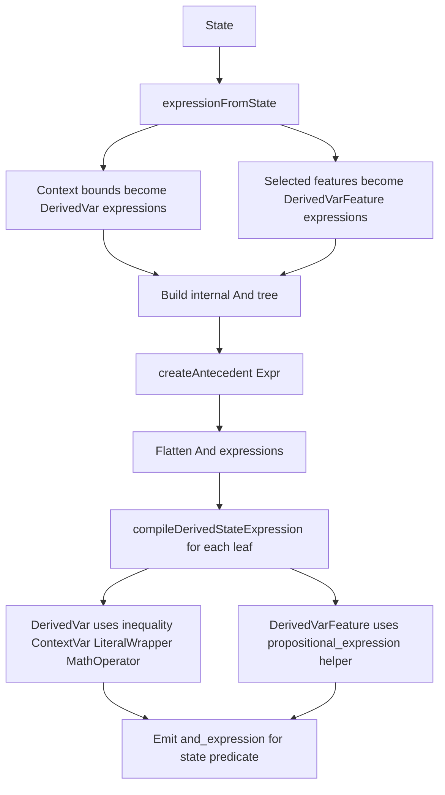

# TQLGenerator Guard Flow

This note explains the current guard-related flow in
`src/eu/coresense/adaptation/generator/TQLGenerator.xtend`.

There are three related paths:

1. User guard CNF is compiled into TQL antecedent expressions.
2. User guard CNF is evaluated against generated states during state pruning.
3. Derived state predicates are compiled through a separate internal `Expr` path.

The important distinction is that user guards use the new grammar nodes:

```text
GuardCNF -> GuardDisjunct -> GuardAtom
```

Derived state predicates use internal helper classes:

```text
Expr -> And / DerivedVar / DerivedVarFeature
```

## High-Level Flow



`ConditionAction.guardCondition` can be `null`. That means the rule is
unguarded. In that case the generator does not create a guard antecedent and
does not attach an `antecedent:` role to the emitted `tactic_rule`.

## User Guard CNF to TQL

This is the path used for guards written in the tactics DSL.



The generated TQL follows CNF structure:

```text
GuardCNF:
  all clauses must hold

GuardDisjunct:
  at least one atom in the clause must hold
```

So multiple terms inside one disjunct become an `or_expression`, and multiple
CNF clauses become an `and_expression`.

## Atom Compilation

`compileAtom(GuardAtom atom)` is just a dispatcher:



### Context Comparison

Example DSL guard:

```text
c_thruster_1 == "OK"
```

The comparison path is:



Rough TQL shape:

```tql
$<expr>_rhs isa ValueString, has string_value "OK";
$<expr> (lhs_value: $t_measured_c_thruster_1, rhs_value: $<expr>_rhs) isa equal, has expression_name "<expr>";
```

Supported operand combinations for TQL emission:

```text
ContextVar op Literal
Literal op ContextVar
ContextVar op ContextVar
Literal op Literal
```

### Feature Selection

Positive feature selection:

```text
selected(suave_resolution.RECOVER_MOTION)
```

TQL shape:

```tql
$<base_name> (atom: $<feature_name>) isa propositional_expression, has expression_name "<base_name>";
```

Negated feature selection:

```text
!selected(suave_resolution.RECOVER_MOTION)
```

TQL shape:

```tql
$<base_name> (atom: $<feature_name>) isa propositional_expression, has expression_name "<base_name>";
$<base_name>_not (expression: $<base_name>) isa not_expression, has expression_name "<base_name>_not";
```

For negated selections, the returned expression name is the wrapper
`<base_name>_not`, because that is the expression the enclosing OR or AND must
reference.

## Guard Satisfaction Against States

This path does not emit TQL. It decides whether a generated state can satisfy a
rule guard.



The expression:

```xtend
guardClauses(cnf).forall[clause |
    guardTerms(clause).exists[atom |
        atomSatisfied(atom, contextKeys, featureKeys, state)
    ]
]
```

means:

```text
For every CNF clause:
  at least one atom in that clause must be true in this state.
```

That is the standard CNF rule:

```text
(a OR b) AND (c OR d)
```

## Derived State Antecedents

This is separate from user guard CNF. It is used when the generator creates TQL
for the internally generated states.



This path intentionally rejects `Or` expressions:

```text
OR expressions are not supported in derived state antecedents
```

That is unrelated to user guard CNF. User guard OR is handled by
`compileDisjunct(GuardDisjunct)` and emits `or_expression`.

## Quick Mental Model

Use this mapping when reading the code:

```text
compileRule
  Decides whether a rule has a guard antecedent.

createAntecedent(GuardCNF)
  Compiles user guard CNF into TQL.

compileDisjunct(GuardDisjunct)
  Compiles one OR clause.

compileAtom(GuardAtom)
  Compiles one leaf guard expression.

guardSatisfied
  Evaluates the same user guard CNF against a generated state.

createAntecedent(Expr)
  Compiles internally derived state predicates, not user guards.
```
